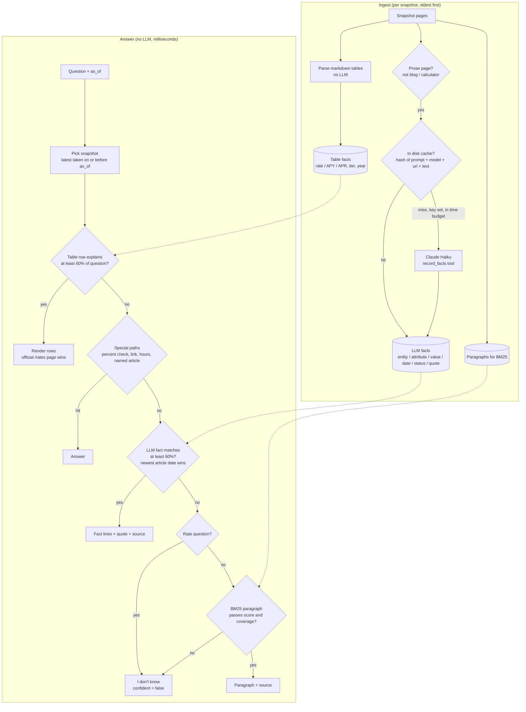

# llm_facts: design notes

**Approach.** Answers come from structured facts, not from a model reading pages at question time. At ingest each snapshot is turned into two fact stores. (1) Every markdown table row becomes a `Fact` (topic, row label, rate/APY/APR/minimums, balance tier, model-year range, source page), parsed deterministically in `table_facts.py`. (2) Every prose page (branches, hours, newsroom, product pages) is read once by Claude Haiku with a forced `record_facts` tool call. It returns entity / attribute / value / qualifiers / effective date / status / verbatim quote. Extractions are cached on disk by hash of (prompt version, model, URL, page text), so an unchanged page across snapshots costs nothing and reruns are free. Answering uses no LLM and takes milliseconds. The question is tokenised, weighted by idf (generic words like "rate" or "current" are dropped, synonyms such as cd→certificate are expanded), and matched against the table rows first, then the LLM facts, then a BM25 paragraph fallback. If nothing explains at least 60% of the question's weight, it says "I don't know" and does not guess. Table qualifiers (refinance only if asked, the model year given, the tier containing the stated dollar amount) are applied before rendering. There are a few narrow special paths: a check of a stated percentage ("does anything pay 0.35%?"), all credit cards listed from every page, hours overviews across branches, call-to-action links taken from page anchors, and "recognition from <Name>" answered from the newest article naming that organisation.

**What is current.** There are three layers.
- *Across snapshots:* each snapshot keeps its own stores. With no `as_of` the newest snapshot answers, and with `as_of` the latest snapshot taken on or before that date answers. A fact that disappears from the website therefore never leaks into a newer answer.
- *Within a snapshot, when sources disagree:* table rows from the official rate sheets (`/rates`, `/business-rates`) outrank the same row on other pages, and only the top-priority page is rendered. For prose facts the tie-break is the article's own publication date (parsed from the page), not crawl time, because every page in a crawl has almost the same fetch time. Undated pages never outrank dated ones. This is how "how many branches?" resolves to the newest press-release figure instead of the older 23 and 24. The LLM also marks facts that the page itself calls expired or superseded as `status=expired`, and those are never returned. `conflicts()` reports both kinds of disagreement, with the winner and the reason ("official rate sheet", "newest page", "most recently published page").
- *When nothing current exists:* rate questions with no matching row, product prose with no `%`, and capitalised names that appear nowhere on the site all get a calibrated "I don't know / contact Dupaco" with `confident=False`, not an old or invented number.

**API keys.** The only key is `ANTHROPIC_API_KEY`, and it is used only at ingest, to run the fact extraction (`pip install anthropic`). Optional env vars are `LLM_FACTS_MODEL` (default `claude-haiku-5-5`), `LLM_FACTS_WORKERS` (default 8), `LLM_FACTS_BUDGET_S` (default 1500, after which the LLM is no longer called for uncached pages so ingest stays under the time limit) and `LLM_FACTS_CACHE`. Without a key the system still works. It uses the committed `cache/` directory for pages already extracted, the table facts, and BM25, and only brand-new uncached pages lose their LLM facts. Answering never needs a key. `--judge` in the eval harness is a separate grader and is not used by the solution.
